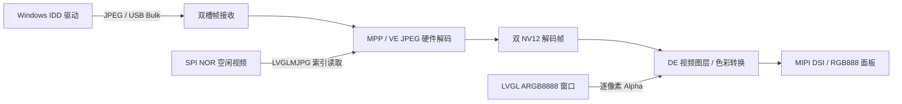
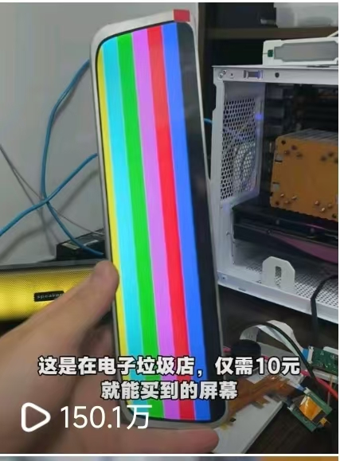

# AIC-BarDisplay

**匠芯创 D125 / D133 长条 USB 副屏固件平台**

AIC-BarDisplay 将 ArtInChip Luban-Lite 中实际使用的 bootloader、芯片底层、RT-Thread/OSAL、CherryUSB、MPP 和 LVGL 剥离为独立固件工程。面向 **8 MiB PSRAM + 32 MiB SPI NOR** 硬件，使用主机 JPEG 帧传输、芯片硬件解码与 DE 图层合成，生成三款 MIPI DSI 长条屏在两种主控上的六个固件版本。

相比此前采用闭源副屏库的方案，开源版性能更优（更好的JPEG解码质量），显示效果更优（原RGB565 -> 全链路RGB888），稳定性更优（透明且更为合理的RAM管理）

## 技术架构



- **传输与解码分离**：USB 回调负责收包与帧状态推进，不在回调内分配内存、等待阻塞锁或执行 JPEG 解码。
- **硬件视频通路**：JPEG 帧经 VE 解码为 NV12，由 DE 视频图层显示并完成输出色彩转换。
- **原生分辨率**：设备向主机声明实际宽高。
- **逐像素透明合成**：待机/设置 UI 使用 ARGB8888，独立于 NV12 视频层；
- **受控内存生命周期**：空闲视频与副屏共用 RX 缓冲和解码资源；进入副屏时清理 LVGL 页面对象及动画，保留可复用的 LVGL 核心与 display 实例。
- **固定固件生成链**：Python 直接调度 GCC、链接脚本、文件系统生成器和 IMG 打包器，无需原 SDK、SCons、Kconfig、Python 2 或联网安装。


## 硬件与屏幕

使用 [开源 D125/D133 双 PCB 硬件方案](https://oshwhub.com/an_ye/project_tebvlwzd)。请选择与实际 PCB 主控一致的固件；本工程中 D125 对应 `d12p`，D133 对应 `d13x`。

默认分区和 IMG 按 **32 MiB（256 Mbit，Q256 容量级）SPI NOR** 配置，需要贴装兼容的 32 MiB Flash；

| 屏幕 | 原生分辨率（宽×高） | D125 固件 | D133 固件 |
| --- | --- | --- | --- |
| TXW935003B | 480×1920 | [d125-txw935003b.img](images/d125-txw935003b.img) | [d133-txw935003b.img](images/d133-txw935003b.img) |
| BOE1126 | 440×1920 | [d125-boe1126.img](images/d125-boe1126.img) | [d133-boe1126.img](images/d133-boe1126.img) |
| AV092K5U | 462×1920 | [d125-av092k5u.img](images/d125-av092k5u.img) | [d133-av092k5u.img](images/d133-av092k5u.img) |

| AV092K5U | BOE1126 |
| --- | --- |
|  |  |

TXW935003B 来自 360 行车记录仪拆机屏，适配过程涉及缺少完整厂商资料时的接口与初始化序列分析，相关记录见 [360 MX30 9.35 英寸 MIPI 屏项目](https://github.com/panyihang/360_MX30_9-35-MIPI_DISPLAY)。当前固件采用的有效分辨率为 **480×1920**。



## USB 协议与主机驱动

设备组合提供三类接口：

| 接口 | 功能 |
| --- | --- |
| Vendor / Bulk | 接收主机 JPEG 副屏帧；应用采用 16 字节协议头与两槽接收队列 |
| HID | 保留五点触摸报告协议；当前 PCB 无触摸输入，不产生实际触点 |
| MSC | 暴露只读 FAT 资源盘，包含 Windows 驱动安装包和空闲视频；拒绝写入 |

Windows 端参考开源 IDD 协议。将匹配的 IMG 烧录后，通过 USB 数据线连接主机，从资源盘获取 `usb_graphic_250224.exe`，完成驱动安装后在 Windows 显示设置中配置副屏。

设备产品字符串与 Vendor 接口字符串携带能力声明，例如：

```text
esp32p4udisp0_R480x1920_Ejpg6_Fps60_Bl292
```

其中 `R` 为原生宽高，`Ejpg6` 为驱动协议的 JPEG 质量档位，`Fps60` 为主机提交帧率上限，`Bl292` 为压缩帧预算（KiB）。固件单帧接收上限为 **300,000 bytes**，对主机向下声明为 292 KiB。

**60 FPS 是协议声明上限，不是六款固件的实测持续帧率承诺。** 实际吞吐取决于画面内容、JPEG 大小、USB 传输和解码/呈现耗时。面板扫描刷新率还受 `pixelclock` 与水平/垂直总时序约束，不能仅通过修改 `fps` 改变。

## 8 MiB PSRAM 下的显示与内存布局

以 480×1920 的 TXW935003B 为例：

| 资源 | 配置与用途 | 量级 |
| --- | --- | --- |
| 基础 framebuffer | 一份全屏 RGB888 分配 | 2,764,800 bytes，约 2.64 MiB |
| JPEG RX | 两槽，每槽 300,000 bytes；空闲视频复用其中一槽 | 600,000 bytes，约 0.57 MiB |
| 解码输出 | 两份全屏 NV12，保留可见帧至下一帧切换 | 合计约 2.64 MiB |
| 待机 UI | 两个 400×480 ARGB8888 窗口，复用基础 framebuffer 分配 | 1,536,000 bytes，**不额外叠加分配** |
| PSRAM SW 保留区 | 应用固定配置为 1 MiB | 其余预算用于 CMA/多媒体资源 |

待机 UI 是居中的 1:1 窗口，双缓冲整窗渲染后切换；背景视频由 DE 视频层扫描输出。副屏模式关闭 UI 图层并释放页面对象，避免 LVGL 与解码器争抢额外的大块内存。

副屏运行时串口周期输出 `usbdisp perf`，包含接收字节率、完整帧/丢帧计数、解码与显示速率、平均耗时及错误计数。可据此区分传输、解码和显示瓶颈；它是工作线程内的诊断，线程阻塞时日志也可能停止。

## 空闲视频、设置与 Flash

空闲页循环播放 `application/rt-thread/usbdisp/assets/video/video.bin`。当前资源采用参考工程的 `LVGLMJPG` 容器：64 字节头、逐帧偏移/长度索引和独立 JPEG 帧。索引按需从 Flash 读取，不常驻缓存整张索引表。

当前视频为 **480×1920、30 FPS、602 帧**，使用 baseline JPEG / 4:2:0，编码质量 33，大小 25,908,703 bytes；最大单帧 45,153 bytes。质量 33 是此视频资源的编码参数，与 USB 驱动协议的 `Ejpg6` 不同。窄屏使用居中且符合色度对齐要求的裁剪，不缩放。

设置页由 LVGL 实现，隐藏待机页、HID 开关等设置保存到 `/data/udisp.cfg`。当前无物理触摸，设置可通过串口命令操作；、

串口控制台：D125 使用 UART0，D133 使用 UART6，115200 / 8N1。空闲页状态下可执行：

```text
udisp settings       # 打开设置页
udisp back           # 返回空闲页
udisp page_hide 1    # 隐藏待机页；0 恢复
udisp hid 0          # 关闭 HID 触摸报告；1 开启
udisp status         # 查看连接、帧与错误计数
```

| 分区 | D125 | D133 | 用途 |
| --- | --- | --- | --- |
| `spl` | 512 KiB | 512 KiB | 共享 bootloader |
| `env` / `env_r` | 各 128 KiB | 各 128 KiB | 环境变量及冗余副本 |
| `userid` | 256 KiB | — | D125 保留分区 |
| `os` | 3 MiB | 3 MiB | 副屏应用 |
| `rodata` | 27 MiB | 27 MiB | 只读 FAT 资源盘 |
| `data` | 1 MiB | 1 MiB | 可写设置区 |

具体布局以 `target/<chip>/display-nor/pack/image_cfg.json` 为准。镜像内包含 bootloader 和应用，同一芯片的三款屏复用一套 bootloader，屏参差异进入应用固件。

## 本地生成固件

Windows 64 位，工程内置 GCC 和 Python 运行时。将工程放在**不含空格的路径**，在命令行运行：

```bat
build.cmd                                 :: 编译全部六个版本
build.cmd d125-txw935003b                  :: 只编译一个版本
build.cmd d125-boe1126 d133-boe1126         :: 同时选择多个版本
build.cmd --list                          :: 列出版本
build.cmd --jobs 8 --keep-build            :: 保留 ELF、map、编译日志和缓存
build.cmd --clean                         :: 删除 build/ 和 images/，包括已生成 IMG
```

输出为 `images/<版本>.img`，本次选择的镜像清单及 SHA256 写入 `images/manifest.json`。成功构建默认清理中间文件；失败时保留 `build/` 便于诊断。

每次生成均检查打包组件范围、IMG 内 bootloader/资源内容、视频文件 SHA256 和 32 MiB NOR 分区边界。已有两套 bootloader 与六个应用的编译/打包验证记录见 `images/validation.json`；编译与资源检查通过不替代实际 PCB 上的显示、连续传输和模式切换测试。

## 添加屏参版本

入口为 `variants.json`，每个条目由芯片/屏初始化模板和基础参数组成：

| 字段 | 作用 |
| --- | --- |
| 版本条目名称 | 命令行选择名及 IMG 文件名，例如 `d125-txw935003b` |
| `chip` / `graph` | 芯片及固定源码/编译模板，不能跨 D125/D133 混用 |
| `product` / `version` | IMG 产品标识与版本号 |
| `timing.width` / `height` | 原生分辨率，也用于 USB 能力声明；NV12 要求宽高为偶数 |
| `pixelclock` | 面板像素时钟，单位 Hz |
| `hfront_porch` / `hback_porch` / `hsync_len` | 水平前肩、后肩、同步宽度，单位像素时钟 |
| `vfront_porch` / `vback_porch` / `vsync_len` | 垂直前肩、后肩、同步宽度，单位行 |
| `lane_num` / `ln_assign` / `ln_polrs` | DSI lane 数量、映射与极性；JSON 使用十进制数 |
| `fps` / `jpeg_quality` | 主机协议的帧率上限与 JPEG 质量档位 |

同一面板控制器、兼容 PCB/初始化序列下，复制一个条目、修改唯一名称和参数即可生成新版本。`ln_assign: 291` 对应 `0x0123`。扫描刷新率可按 `pixelclock / (水平总像素 × 垂直总行数)` 核算，配置时应与屏规格对应。

更换控制器或面板寄存器初始化表时，还需修改 `bsp/artinchip/drv/display/panel/` 下的驱动，并更新 `firmware/graphs/`、`firmware/configs/` 中对应模板。仅修改 JSON 不能自动适配未知屏；

## 关键源码

| 位置 | 内容 |
| --- | --- |
| `build.py`、`build.cmd` | 专用编译、配置头生成、打包、验证与清理入口 |
| `variants.json` | 六个版本及后续屏参变体 |
| `firmware/configs/`、`firmware/graphs/` | 固定配置头、实际参与编译的源码与库清单 |
| `application/rt-thread/usbdisp/` | USB 帧接收、解码呈现、LVGL UI、资源视频与设置 |
| `bsp/artinchip/` | 芯片启动、HAL/驱动及三款面板初始化 |
| `application/baremetal/bootloader/` | 芯片共用的启动与升级代码 |
| `kernel/`、`packages/` | 经实际依赖裁剪的 OS、USB、文件系统、MPP、LVGL 基础 |

工程采用显式源码清单，不再提供通用 SDK 配置菜单。构建工具可独立运行，保留的底层源码目录便于定位硬件问题。